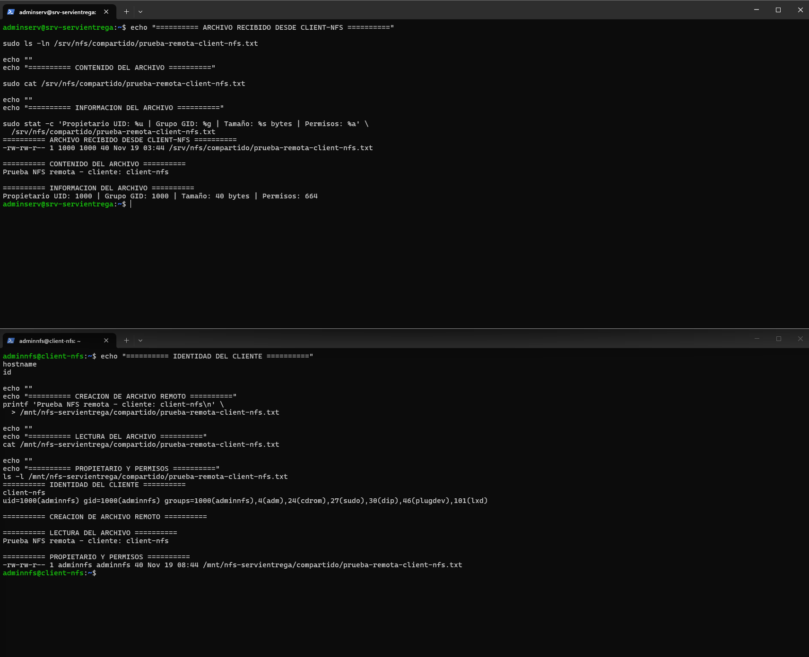
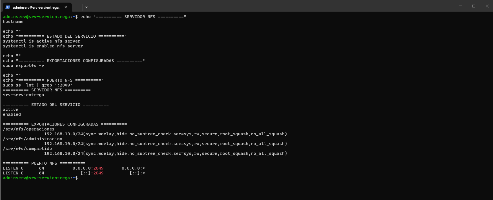
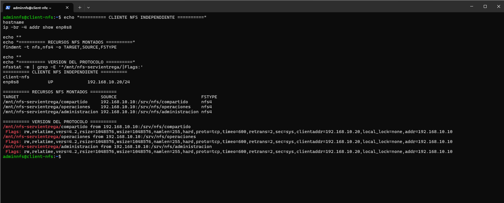

# 05. Servicio NFS — Almacenamiento compartido de archivos

**Organización:** Servientrega S.A. — sede simulada  
**Servidor:** `srv-servientrega` (`192.168.10.10`)  
**Cliente de validación:** `client-nfs` (`192.168.10.20`)  
**Sistema operativo:** Ubuntu Server 24.04.5 LTS  
**Protocolo validado:** NFSv4.2 sobre TCP  
**Estado:** Implementado; montajes y transferencia remota verificados

## 1. Objetivo

Implementar un servicio centralizado de archivos mediante Network File System (NFS), con espacios compartidos para Operaciones, Administración y uso general. Comprobar que un equipo Linux independiente pueda descubrir las exportaciones, montar los tres recursos y leer y escribir un archivo en el recurso común.

## 2. Alcance y resultados

El servicio se instaló y configuró en `srv-servientrega`. Se verificaron localmente el estado del servicio, las exportaciones y el comportamiento de los permisos departamentales. Posteriormente se desplegó un cliente independiente, `client-nfs`, desde el cual se montaron simultáneamente las tres exportaciones con NFSv4.2.

**Alcance de la validación remota:** montaje de los tres recursos; escritura y lectura en `/srv/nfs/compartido`; confirmación del mismo archivo directamente en el servidor. **No se realizaron pruebas remotas de acceso cruzado entre departamentos ni de `root_squash` desde el cliente independiente.**

## 3. Arquitectura y entorno

| Elemento | Configuración |
|---|---|
| Hipervisor | Oracle VirtualBox |
| Servidor NFS | `srv-servientrega` |
| Sistema operativo del servidor | Ubuntu Server 24.04.5 LTS |
| IP de servicio | `192.168.10.10/24`, interfaz Host-only `enp0s8` |
| Red autorizada para exportaciones | `192.168.10.0/24` |
| Cliente de pruebas | `client-nfs`, Ubuntu Server 24.04.5 LTS |
| IP del cliente | `192.168.10.20/24`, interfaz Host-only `enp0s8` |
| Conectividad adicional del cliente | NAT por `enp0s3` |
| Transporte NFS | TCP, puerto 2049 |
| Versión utilizada en los montajes | NFSv4.2 |
| Seguridad del montaje | `sec=sys` (AUTH_SYS) |

La comunicación entre las máquinas se realiza a través de la red Host-only de VirtualBox. Esta arquitectura permite probar el acceso remoto sin publicar las exportaciones en redes externas. El servidor dispone de otros servicios de infraestructura que se conservaron durante la implementación.

## 4. Requisitos previos

- Servidor y cliente con conectividad IP en la red `192.168.10.0/24`.
- Acceso administrativo mediante `sudo` al servidor y al cliente.
- Servicio NFS disponible en el servidor y puerto TCP 2049 accesible.
- Herramientas de cliente NFS (`nfs-common`) instaladas en `client-nfs`.
- Identidades y permisos UNIX configurados para los directorios departamentales.

## 5. Instalación del servidor NFS

Los paquetes identificados durante la implementación fueron `nfs-kernel-server` y `nfs-common`, con versión observada `1:2.6.4-3ubuntu5.1`.

Comandos de instalación de referencia utilizados para estos componentes:

```bash
sudo apt update
sudo apt install -y nfs-kernel-server nfs-common
```

La comprobación final del servicio confirmó `nfs-server` **activo** y **habilitado**. Se observó soporte para las versiones NFSv3, v4, v4.1 y v4.2, así como escucha en TCP 2049 sobre IPv4 e IPv6.

Comandos de diagnóstico y verificación:

```bash
systemctl is-active nfs-server
systemctl is-enabled nfs-server
sudo exportfs -v
sudo ss -lntp | grep ':2049'
```

## 6. Directorios compartidos y permisos

Se configuraron los siguientes recursos en el servidor:

| Recurso | Ruta del servidor | Propietario:grupo | Modo |
|---|---|---|---|
| Operaciones | `/srv/nfs/operaciones` | `root:nfs_operaciones` | `2770` |
| Administración | `/srv/nfs/administracion` | `root:nfs_administracion` | `2770` |
| Compartido | `/srv/nfs/compartido` | `root:root` | `1777` |

Los modos `2770` de las áreas departamentales incluyen el bit **setgid**, destinado a conservar el grupo del directorio en los elementos nuevos. El modo `1777` del área común incluye el bit **sticky**, que limita la eliminación o cambio de nombre de archivos ajenos según las reglas UNIX.

Identidades de prueba utilizadas en la validación local del servidor:

| Identidad | UID | GID | Grupo |
|---|---:|---:|---|
| `usuario_operaciones` | 1001 | 1001 | `nfs_operaciones` |
| `usuario_administracion` | 1002 | 1002 | `nfs_administracion` |

Estas cuentas se configuraron para pruebas de permisos, sin acceso interactivo. El usuario administrativo `adminserv` no se añadió a los grupos departamentales.

## 7. Configuración de exportaciones

Archivo: `/etc/exports`.

```exports
/srv/nfs/operaciones 192.168.10.0/24(rw,sync,no_subtree_check,root_squash)
/srv/nfs/administracion 192.168.10.0/24(rw,sync,no_subtree_check,root_squash)
/srv/nfs/compartido 192.168.10.0/24(rw,sync,no_subtree_check,root_squash)
```

Significado de las opciones:

- `rw`: habilita operaciones de lectura y escritura, sujetas a permisos UNIX.
- `sync`: solicita tratamiento síncrono de las escrituras por el servidor.
- `no_subtree_check`: evita comprobaciones de subárbol en las exportaciones.
- `root_squash`: remapea las solicitudes del usuario root remoto a una identidad sin privilegios.
- `192.168.10.0/24`: limita los clientes autorizados a la subred indicada.

Comandos de administración y consulta:

```bash
sudo exportfs -ra
sudo exportfs -v
sudo systemctl status nfs-server
```

La consulta final de exportaciones mostró las tres rutas configuradas. No fue necesario modificar el cortafuegos para la red aislada de laboratorio.

## 8. Validaciones locales en el servidor

Antes de utilizar un cliente independiente, se efectuaron montajes NFSv4.2 hacia la propia IP de servicio del servidor. Se verificaron operaciones de lectura y escritura, controles de acceso departamental y comportamiento de `root_squash` en ese entorno de prueba.

Los archivos temporales de esa etapa fueron retirados, y los puntos de montaje locales utilizados para el diagnóstico se desmontaron. Al finalizar, el servicio continuaba activo y las exportaciones permanecían disponibles.

**Limitación:** estas pruebas locales no sustituyen una comprobación de permisos realizada desde un equipo remoto; por ello, las conclusiones sobre acceso remoto se restringen a los ensayos descritos a continuación.

## 9. Preparación del cliente independiente

Se instaló una segunda máquina virtual en VirtualBox con las siguientes características:

| Parámetro | Valor |
|---|---|
| Nombre y hostname | `client-nfs` |
| Sistema operativo | Ubuntu Server 24.04.5 LTS |
| Memoria RAM | 2 GB |
| Procesadores virtuales | 2 |
| Disco virtual | 20 GB, dinámico |
| Adaptador 1 | NAT (`enp0s3`, DHCP `10.0.2.15/24` durante la validación) |
| Adaptador 2 | Host-only (`enp0s8`, `192.168.10.20/24`) |
| Usuario administrativo | `adminnfs` |

Se confirmó conectividad mediante `ping` hacia `192.168.10.10` y acceso SSH desde Windows hacia `192.168.10.20`. La prueba de conectividad TCP hacia el servicio NFS en `192.168.10.10:2049` respondió correctamente.

En el cliente se instaló `nfs-common`:

```bash
sudo apt update
sudo apt install -y nfs-common
```

Se verificó la disponibilidad de `mount.nfs` y `showmount`, y la consulta siguiente mostró las tres exportaciones del servidor:

```bash
showmount -e 192.168.10.10
```

## 10. Montaje remoto de los recursos

Se crearon tres puntos de montaje en `client-nfs`:

```bash
sudo mkdir -p \
  /mnt/nfs-servientrega/compartido \
  /mnt/nfs-servientrega/operaciones \
  /mnt/nfs-servientrega/administracion
```

Los tres montajes se ejecutaron correctamente:

```bash
sudo mount -v -t nfs -o vers=4.2,proto=tcp \
  192.168.10.10:/srv/nfs/compartido \
  /mnt/nfs-servientrega/compartido

sudo mount -v -t nfs -o vers=4.2,proto=tcp \
  192.168.10.10:/srv/nfs/operaciones \
  /mnt/nfs-servientrega/operaciones

sudo mount -v -t nfs -o vers=4.2,proto=tcp \
  192.168.10.10:/srv/nfs/administracion \
  /mnt/nfs-servientrega/administracion
```

Se comprobaron los montajes con:

```bash
findmnt -t nfs,nfs4
nfsstat -m
```

**Resultado observado:** las tres rutas aparecieron montadas simultáneamente con tipo `nfs4` y opciones `rw`, `vers=4.2`, `proto=tcp`, `sec=sys`, `clientaddr=192.168.10.20` y `addr=192.168.10.10`. Los mensajes `timeout set for ...` producidos por `mount -v` fueron informativos; las verificaciones posteriores confirmaron que los montajes se completaron.

## 11. Prueba funcional de escritura y lectura remota

### 11.1. Operación realizada en `client-nfs`

Con el usuario `adminnfs` (UID 1000, GID 1000), se creó un archivo en el recurso compartido:

```bash
printf 'Prueba NFS remota - cliente: client-nfs\n' \
  > /mnt/nfs-servientrega/compartido/prueba-remota-client-nfs.txt

cat /mnt/nfs-servientrega/compartido/prueba-remota-client-nfs.txt
ls -l /mnt/nfs-servientrega/compartido/prueba-remota-client-nfs.txt
```

Se leyó correctamente el contenido:

```text
Prueba NFS remota - cliente: client-nfs
```

La consulta de permisos mostró un archivo de 40 bytes, con propietario y grupo `adminnfs:adminnfs` en el cliente y modo `-rw-rw-r--`.

### 11.2. Confirmación directa en `srv-servientrega`

Desde una sesión SSH independiente en el servidor se ejecutaron:

```bash
sudo ls -ln /srv/nfs/compartido/prueba-remota-client-nfs.txt
sudo cat /srv/nfs/compartido/prueba-remota-client-nfs.txt
sudo stat -c 'Propietario UID: %u | Grupo GID: %g | Tamaño: %s bytes | Permisos: %a' \
  /srv/nfs/compartido/prueba-remota-client-nfs.txt
```

**Resultados efectivamente observados:**

```text
-rw-rw-r-- 1 1000 1000 40 ... /srv/nfs/compartido/prueba-remota-client-nfs.txt
Prueba NFS remota - cliente: client-nfs
Propietario UID: 1000 | Grupo GID: 1000 | Tamaño: 40 bytes | Permisos: 664
```

La coincidencia de contenido, tamaño e identidades numéricas confirma que el archivo creado desde `client-nfs` se encuentra en el almacenamiento exportado por `srv-servientrega`, y no solamente en un directorio local del cliente.

## 12. Matriz de validación

| Comprobación | Resultado | Alcance |
|---|---|---|
| Servicio NFS activo y habilitado | Aprobado | Servidor |
| Exportaciones configuradas y visibles | Aprobado | Servidor y cliente |
| Puerto TCP 2049 accesible | Aprobado | Cliente independiente |
| Montaje de `compartido` | Aprobado | Cliente independiente |
| Montaje de `operaciones` | Aprobado | Cliente independiente |
| Montaje de `administracion` | Aprobado | Cliente independiente |
| Montajes simultáneos NFSv4.2 | Aprobado | Cliente independiente |
| Escritura y lectura en `compartido` | Aprobado | Cliente independiente |
| Archivo remoto confirmado en servidor | Aprobado | Dos equipos |
| Controles departamentales | Probados localmente | Servidor |
| `root_squash` | Probado localmente | Servidor |
| Aislamiento departamental desde cliente remoto | No ejecutado | Fuera del alcance final |
| `root_squash` desde cliente remoto | No ejecutado | Fuera del alcance final |

## 13. Incidencias y resolución

### 13.1. Intento inicial desde WSL 2

El intento de montaje desde Ubuntu en WSL 2 no se completó; se observaron errores como `Invalid argument` y `Operation not permitted`. Para obtener una prueba independiente y representativa, se preparó una máquina virtual Ubuntu Server dedicada (`client-nfs`). Desde ella, los tres montajes se completaron correctamente.

### 13.2. Respuesta temporal de la consola del cliente

Durante las pruebas iniciales, la consola de la VM pareció dejar de responder. Se comprobó desde Windows que `192.168.10.20` respondía a ICMP sin pérdida y que TCP 22 estaba accesible. Posteriormente se estableció una sesión SSH y se continuó la validación sin modificar la configuración del servicio NFS.

### 13.3. Mensajes de tiempo de espera durante el montaje

`mount.nfs -v` mostró mensajes del tipo `timeout set for ...`. No se trató de un fallo efectivo: `findmnt` y `nfsstat -m` confirmaron los montajes activos.

## 14. Evidencias visuales

Las evidencias del servicio NFS se almacenan en `AdminTI/capturas/`. Los nombres y números siguientes corresponden a la secuencia definitiva indicada para el proyecto; las rutas relativas parten de `AdminTI/infraestructura/05-servicio-nfs.md`.

| N.º | Evidencia | Archivo |
|---|---|---|
| 18 | Validación remota cliente-servidor: creación y lectura en `client-nfs`, confirmación del archivo en `srv-servientrega` | `18-nfs-validacion-remota-cliente-servidor.png` |
| 19 | Estado del servicio NFS y exportaciones configuradas en el servidor | `19-nfs-estado-servicio-exportaciones.png` |
| 20 | Tres recursos NFSv4.2 montados simultáneamente en el cliente independiente | `20-nfs-montajes-remotos-cliente.png` |

### 14.1. Evidencia 18 — Confirmación de acceso remoto entre dos equipos



La captura documenta la prueba funcional de escritura y lectura en el recurso `compartido`, junto con la verificación del mismo archivo en el servidor.

### 14.2. Evidencia 19 — Estado del servicio y exportaciones



Esta evidencia corresponde a la consulta del estado del servicio y de las tres rutas exportadas en `srv-servientrega`.

### 14.3. Evidencia 20 — Montajes remotos simultáneos



Esta evidencia corresponde a la consulta de los montajes activos y de sus opciones de protocolo desde `client-nfs`.

## 15. Operación y mantenimiento

Para inspeccionar el estado del servicio y las exportaciones en el servidor:

```bash
systemctl status nfs-server
sudo exportfs -v
sudo ss -lntp | grep ':2049'
```

Para revisar los montajes desde un cliente:

```bash
findmnt -t nfs,nfs4
nfsstat -m
```

Ante un problema de acceso, comprobar por separado: conectividad IP, puerto TCP 2049, exportación autorizada, montaje activo y permisos UNIX asociados a los UID/GID del cliente. Dado que se utiliza `sec=sys`, los permisos dependen de identidades numéricas y de la confianza en el cliente autorizado; el montaje por sí solo no demuestra autorización de lectura o escritura sobre todos los directorios.

Para desmontar los recursos **cuando ya no se necesiten**, y siempre que no existan procesos utilizándolos:

```bash
sudo umount /mnt/nfs-servientrega/administracion
sudo umount /mnt/nfs-servientrega/operaciones
sudo umount /mnt/nfs-servientrega/compartido
```

**Estado de cierre:** no se ha confirmado en esta documentación la eliminación del archivo `prueba-remota-client-nfs.txt` ni el desmontaje final de los recursos del cliente; por tanto, no se declaran ejecutadas esas acciones. No se configuró montaje persistente en `/etc/fstab` como parte de esta validación.

## 16. Conclusiones

El servicio NFS quedó operativo en `srv-servientrega` con tres exportaciones diferenciadas. Un cliente Ubuntu Server independiente, `client-nfs`, consiguió montar simultáneamente las tres rutas con NFSv4.2 sobre TCP. Además, se creó y leyó un archivo desde el cliente, y se verificó directamente en el servidor su contenido, tamaño, UID, GID y permisos.

Estas evidencias permiten **confirmar el acceso remoto y el funcionamiento del almacenamiento compartido**, particularmente las operaciones de lectura y escritura en el recurso general. La comprobación remota de permisos departamentales y de `root_squash` no se incluyó en el alcance final, por decisión de cierre de las pruebas; por ello, no se afirma una validación integral de esos controles desde un cliente independiente.
