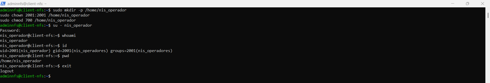
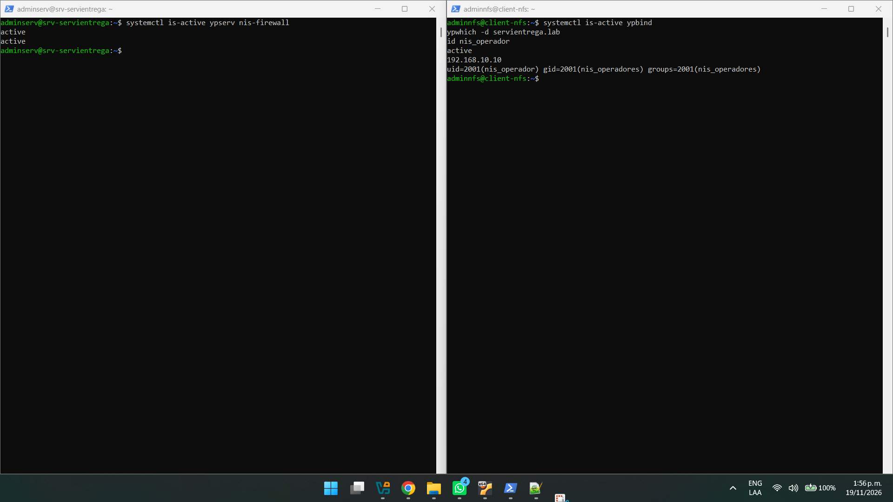

# 06. Servicio NIS — Centralización de cuentas Linux

**Proyecto:** Infraestructura de TI — Sede simulada de Servientrega S.A.  
**Requisito:** RF-07 — Centralizar cuentas de prueba Linux mediante NIS.  
**Estado:** Implementación y validación funcional aprobadas; verificación del aislamiento desde la red externa pendiente.  
**Fecha de validación:** 19 de noviembre de 2026.  
**Entorno:** Ubuntu Server 24.04 LTS, máquinas virtuales en VirtualBox.

## 1. Objetivo y alcance

Implementar un servicio de información de red **NIS (Network Information Service)** que permita administrar identidades Linux de prueba desde un servidor central y utilizarlas para iniciar sesión en un cliente Ubuntu, sin crear las cuentas en el archivo local `/etc/passwd` de cada equipo.

La implementación corresponde a un **laboratorio de infraestructura**. NIS es un protocolo heredado que no ofrece confidencialidad criptográfica para las consultas y no se recomienda para identidades reales o redes no confiables. Por este motivo, se emplean exclusivamente cuentas ficticias, contraseñas exclusivas de laboratorio y restricciones de acceso por red.

**Fuera de alcance:** uso de credenciales corporativas reales, despliegue en producción, administración centralizada de contraseñas mediante `yppasswdd` y migración de otros servicios existentes.

## 2. Arquitectura implementada

| Componente | Servidor | Cliente |
|---|---|---|
| Nombre de equipo | `srv-servientrega` | `client-nfs` |
| Usuario administrativo local | `adminserv` | `adminnfs` |
| Interfaz interna Host-only | `enp0s8` | `enp0s8` |
| Dirección interna | `192.168.10.10/24` | `192.168.10.20/24` |
| Otra interfaz | `enp0s3`, puente, `192.168.80.46/24` | `enp0s3`, NAT, `10.0.2.15/24` |
| Función NIS | Publicación de mapas mediante `ypserv` | Vinculación mediante `ypbind` y resolución mediante NSS |

- **Dominio NIS:** `servientrega.lab`.
- **Servidor NIS:** `192.168.10.10`.
- **Puerto fijo de `ypserv`:** TCP/UDP `834`.
- **Programa RPC:** `100004`, versiones 1 y 2.
- **Red autorizada en la configuración:** `192.168.10.0/24`, además del acceso local.
- **Servicio RPC compartido:** `rpcbind`, puerto 111; también utilizado por otros servicios de infraestructura.

```text
                      Red Host-only 192.168.10.0/24

  srv-servientrega                                client-nfs
  192.168.10.10                                  192.168.10.20
  ┌────────────────────────┐                     ┌─────────────────────────┐
  │ Fuentes /etc/nis-data  │                     │ ypbind                  │
  │ passwd y group         │                     │ /etc/yp.conf            │
  │          ↓             │   RPC / NIS :834    │ NSS: files systemd nis  │
  │ Mapas /var/yp/...      │◄───────────────────►│ PAM: pam_unix           │
  │ ypserv                 │                     │ su - nis_operador       │
  │ nftables: nis_protection│                    │                         │
  └────────────────────────┘                     └─────────────────────────┘
```

El nombre del dominio NIS coincide con el dominio utilizado en el laboratorio, pero **NIS y DNS son servicios distintos**.

## 3. Requisitos previos

- Comunicación IP entre `192.168.10.20` y `192.168.10.10` por la interfaz Host-only.
- Acceso administrativo `sudo` a ambos equipos y acceso SSH conservado para los usuarios locales.
- Paquetes disponibles desde los repositorios Ubuntu.
- Servicio `rpcbind` operativo.
- Identificadores UID/GID reservados para cuentas de prueba, sin conflictos con las cuentas existentes.
- Configuración del firewall NIS activa antes de iniciar `ypserv`.

**Criterio de protección:** no modificar los UID/GID existentes, la autenticación administrativa local ni la configuración de otros servicios operativos.

## 4. Instalación y configuración del servidor

### 4.1. Paquetes y arranque controlado

En `srv-servientrega` se instalaron los componentes NIS necesarios, incluidos `ypserv`, `ypbind-mt`, `yp-tools`, `libnss-nis`, `nscd` y dependencias. Durante la instalación se utilizó temporalmente `/usr/sbin/policy-rc.d` con salida `101` para impedir el inicio automático de servicios antes de configurarlos.

```bash
sudo tee /usr/sbin/policy-rc.d > /dev/null <<'EOF_POLICY'
#!/bin/sh
exit 101
EOF_POLICY
sudo chmod 755 /usr/sbin/policy-rc.d
```

Se conservaron respaldos previos de los archivos de cuentas y NSS en `/root/respaldo-pre-nis/`. La configuración NSS del **servidor** no se modificó: `passwd`, `group` y `shadow` continuaron usando `files systemd`. `ypbind` y `yppasswdd` no se habilitaron como servicios del servidor.

### 4.2. Dominio NIS

Archivo `/etc/defaultdomain`:

```text
servientrega.lab
```

Activación del dominio en ejecución:

```bash
sudo domainname servientrega.lab
domainname
```

### 4.3. Puerto fijo del servidor

Archivo `/etc/default/nis`:

```bash
# Configuracion del servicio NIS
# Infraestructura Servientrega S.A.

# Puerto fijo del servidor NIS
YPSERVARGS="-p 834"
```

Se comprobó posteriormente que el proceso real se ejecuta como `/usr/sbin/ypserv -p 834` y que RPC registra el programa `100004` en TCP y UDP, puerto 834.

### 4.4. Restricción de clientes autorizados

Archivo `/etc/ypserv.securenets`:

```text
# Restricciones de acceso al servidor NIS
# Infraestructura Servientrega S.A.
#
# Acceso local IPv4
255.0.0.0       127.0.0.0

# Acceso local IPv6
host            ::1

# Red interna Host-only
255.255.255.0   192.168.10.0
```

La ruta `/var/yp/securenets` se configuró como enlace simbólico a `/etc/ypserv.securenets`. Se conservó un respaldo del archivo de restricciones. La configuración de reglas de mapas de `/etc/ypserv.conf` permaneció con sus valores observados, incluidas las reglas restrictivas para mapas `shadow` y `passwd.adjunct`; no se publicaron tales mapas.

### 4.5. Protección de red mediante nftables

Se creó una tabla independiente para no sustituir las reglas administradas por Docker ni modificar indiscriminadamente los puertos compartidos de RPC.

Archivo `/etc/nftables-nis.conf`:

```nft
 destroy table inet nis_protection
 table inet nis_protection {
     chain input {
         type filter hook input priority -10; policy accept;

         # Consultas locales
         iifname "lo" tcp dport 834 accept
         iifname "lo" udp dport 834 accept

         # Clientes de la red interna Host-only
         iifname "enp0s8" ip saddr 192.168.10.0/24 tcp dport 834 accept
         iifname "enp0s8" ip saddr 192.168.10.0/24 udp dport 834 accept

         # Resto de conexiones dirigidas al puerto NIS
         tcp dport 834 drop
         udp dport 834 drop
     }
 }
```

> Nota: el archivo operativo no requiere espacios iniciales; se muestran únicamente para facilitar la lectura. La instrucción `destroy table` permite reemplazar la tabla durante la carga de reglas.

Validación y aplicación realizadas:

```bash
sudo nft -c -f /etc/nftables-nis.conf
sudo nft -f /etc/nftables-nis.conf
sudo nft list table inet nis_protection
```

Se creó `/etc/systemd/system/nis-firewall.service`:

```ini
[Unit]
Description=Proteccion de red para el servicio NIS
Documentation=man:nft(8)
DefaultDependencies=no
After=local-fs.target
Before=network-pre.target
Wants=network-pre.target
Before=ypserv.service

[Service]
Type=oneshot
ExecStart=/usr/sbin/nft -f /etc/nftables-nis.conf
ExecStop=/usr/sbin/nft delete table inet nis_protection
RemainAfterExit=yes

[Install]
WantedBy=sysinit.target
```

Y la dependencia `/etc/systemd/system/ypserv.service.d/10-nis-firewall.conf`:

```ini
[Unit]
Requires=nis-firewall.service
After=nis-firewall.service
```

Se verificó la definición de systemd, se habilitó `nis-firewall.service` y se confirmó su estado `active (exited)` antes del inicio de `ypserv`.

**Alcance de esta protección:** las reglas presentadas controlan el puerto 834. `rpcbind` continúa escuchando en el puerto 111 para servicios RPC compartidos; por tanto, la existencia de estas reglas **no demuestra por sí sola el aislamiento completo de la información RPC**. La prueba de bloqueo desde la interfaz externa permanece pendiente.

## 5. Fuentes de identidad y mapas NIS

### 5.1. Archivo de cuentas ficticias

Se creó `/etc/nis-data/`, propietario `root:root`, permisos `700`. Sus archivos `passwd` y `group` son propiedad de `root:root`, permisos `600`.

El archivo `/etc/nis-data/passwd` contiene **dos cuentas ficticias** con los siguientes campos de identidad (el campo de hash no se reproduce):

```text
nis_operador:<HASH_SHA512>:2001:2001:Operador NIS de prueba:/home/nis_operador:/bin/bash
nis_consulta:<HASH_SHA512>:2002:2002:Consulta NIS de prueba:/home/nis_consulta:/bin/bash
```

El archivo `/etc/nis-data/group` contiene:

```text
nis_operadores:x:2001:nis_operador
nis_consultas:x:2002:nis_consulta
```

Los campos `<HASH_SHA512>` representan hashes reales generados durante la instalación; **no son valores literales que deban copiarse a un archivo operativo**. Inicialmente las cuentas tenían `!` en el campo de contraseña y, tras las comprobaciones, se generaron hashes SHA-512 crypt (`$6$`) de contraseñas exclusivas de laboratorio. Se creó el respaldo `/etc/nis-data/passwd.pre-auth.bak` antes de actualizar el archivo fuente.

No se crearon estas cuentas en el `/etc/passwd` local del servidor ni se creó un mapa `shadow`. La publicación de hashes en un mapa `passwd` consultable por clientes autorizados implica un riesgo de ataques fuera de línea y es aceptable **solo para esta demostración con cuentas ficticias**.

### 5.2. Configuración de generación de mapas

Se respaldó `/var/yp/Makefile` como `/var/yp/Makefile.pre-nis-servientrega.bak` y se ajustaron las variables utilizadas:

```make
NOPUSH=true
MINUID = 2000
MINGID = 2000
MERGE_PASSWD = false
MERGE_GROUP = false
YPPWDDIR = /etc/nis-data
YPSRCDIR = /etc
ALL = passwd group
```

La carpeta de mapas es `/var/yp/servientrega.lab`. Se generaron únicamente:

```text
passwd.byname
passwd.byuid
group.byname
group.bygid
```

Comandos utilizados:

```bash
# Generación inicial de usuarios y grupos
sudo make -C /var/yp/servientrega.lab -f ../Makefile passwd group

# Regeneración de usuarios tras configurar las contraseñas
sudo make -C /var/yp/servientrega.lab -f ../Makefile passwd

# Inspección local de un mapa; atención: puede mostrar hashes
sudo /usr/lib/yp/makedbm -u /var/yp/servientrega.lab/group.byname
```

Los cuatro mapas fueron verificados con dos registros de identidad o grupo cada uno. Se comprobó que los mapas `passwd` tenían UID/GID correctos y hashes SHA-512 sin mostrarlos en la salida de validación.

Durante la generación, con `ypserv` aún detenido, apareció `failed to send 'clear' to local ypserv: RPC: Program not registered`. No impidió generar ni verificar los mapas.

## 6. Inicio y validación del servidor

El servicio se inició primero sin habilitar el arranque automático:

```bash
sudo systemctl start ypserv.service
systemctl is-active ypserv.service
rpcinfo -p localhost | grep 100004
```

Resultados observados:

- `ypserv`: `active (running)`.
- Proceso principal: `/usr/sbin/ypserv -p 834`.
- TCP y UDP en el puerto 834, tanto IPv4 como IPv6.
- RPC `100004`, versiones 1 y 2, registrado en puerto 834.
- `nis-firewall`: activo.

Se verificó la respuesta RPC local:

```bash
rpcinfo -T tcp localhost 100004 2
```

Resultado: `program 100004 version 2 ready and waiting`.

Consultas de mapas, evitando mostrar hashes:

```bash
ypcat -h 127.0.0.1 -d servientrega.lab passwd.byname \
  | awk -F: '{print $1, "UID:", $3, "GID:", $4, "HOME:", $6}'

ypcat -h 127.0.0.1 -d servientrega.lab group.byname
```

Se obtuvieron las cuentas `nis_operador` (2001/2001) y `nis_consulta` (2002/2002), así como los grupos `nis_operadores` y `nis_consultas`. Las consultas `getent passwd nis_operador` y `getent passwd nis_consulta` **no** resolvían identidades NIS en el servidor, según el diseño de mantener NSS local sin cambios.

**Incidencia menor:** el comando `ypmatch -h ...` falló porque la versión instalada no admite `-h`. Se sustituyó por `ypcat -h ...` con filtro por usuario. También apareció un aviso transitorio de systemd sobre `/run/ypserv.pid`; el proceso quedó activo y RPC respondió correctamente.

## 7. Instalación y configuración del cliente

### 7.1. Comprobaciones previas

En `client-nfs` se confirmó:

- IP interna `192.168.10.20/24` y conectividad con `192.168.10.10` (3 respuestas de 3 paquetes ICMP).
- Usuario administrativo local `adminnfs`, UID/GID 1000, con acceso `sudo`.
- Dominio NIS inicialmente `(none)`.
- `ypbind-mt`, `yp-tools` y `libnss-nis` inicialmente no instalados.
- NSS inicial: `files systemd` en `passwd`, `group` y `shadow`.

### 7.2. Instalación controlada

Se creó temporalmente `/usr/sbin/policy-rc.d` con salida `101` para impedir el arranque automático durante la instalación:

```bash
sudo tee /usr/sbin/policy-rc.d > /dev/null <<'EOF_POLICY'
#!/bin/sh
exit 101
EOF_POLICY
sudo chmod 755 /usr/sbin/policy-rc.d

sudo DEBIAN_FRONTEND=noninteractive apt-get install -y \
  ypbind-mt yp-tools libnss-nis
```

Se instalaron `ypbind-mt 2.7.2-3build1`, `yp-tools 4.2.3-4build1`, `libnss-nis 3.1-0ubuntu7` y las dependencias `libnsl2` y `nscd`. El bloqueo temporal impidió los inicios automáticos previstos. `dpkg --audit` no informó incidencias.

### 7.3. Dominio y servidor explícito

Archivo `/etc/defaultdomain`:

```text
servientrega.lab
```

Activación inmediata:

```bash
sudo domainname servientrega.lab
```

Archivo `/etc/yp.conf`:

```text
# Configuracion del cliente NIS
# Infraestructura Servientrega S.A.

domain servientrega.lab server 192.168.10.10
```

La vinculación se dirigió a una dirección explícita; no se configuró búsqueda por difusión.

### 7.4. Verificación RPC desde el cliente

```bash
rpcinfo -T tcp 192.168.10.10 100004 2
rpcinfo -T udp 192.168.10.10 100004 2
rpcinfo -p 192.168.10.10 | grep 100004
```

**Resultados:** tanto TCP como UDP respondieron `program 100004 version 2 ready and waiting`, con puerto 834 registrado.

### 7.5. Vinculación del cliente

```bash
sudo systemctl start ypbind.service
systemctl is-active ypbind.service
ypwhich -d servientrega.lab
```

Resultados: `ypbind` activo, inicialmente deshabilitado para el arranque, y `ypwhich` devolvió `192.168.10.10`.

**Incidencia menor:** systemd mostró un aviso transitorio relacionado con `/run/ypbind.pid`, sin impedir el inicio ni la vinculación.

### 7.6. Integración de cuentas con NSS

Se respaldó `/etc/nsswitch.conf`:

```bash
sudo cp /etc/nsswitch.conf /etc/nsswitch.conf.pre-nis.bak
```

Después se añadió `nis` únicamente a `passwd` y `group`:

```bash
sudo sed -i \
  -e '/^passwd:/ s/$/ nis/' \
  -e '/^group:/ s/$/ nis/' \
  /etc/nsswitch.conf
```

Configuración resultante esperada de las líneas modificadas:

```text
passwd:         files systemd nis
group:          files systemd nis
shadow:         files systemd
```

El archivo `shadow` no se integró con NIS porque los hashes ficticios están en el mapa `passwd`. No se modificó la configuración PAM del cliente: la autenticación se realizó con el módulo `pam_unix.so` existente y la resolución NSS de las cuentas NIS.

Verificaciones ejecutadas:

```bash
getent passwd nis_operador | cut -d: -f1,3,4,6,7
getent passwd nis_consulta | cut -d: -f1,3,4,6,7
id nis_operador
```

Resultados:

```text
nis_operador:2001:2001:/home/nis_operador:/bin/bash
nis_consulta:2002:2002:/home/nis_consulta:/bin/bash
uid=2001(nis_operador) gid=2001(nis_operadores) groups=2001(nis_operadores)
```

## 8. Prueba funcional de autenticación — RF-07

Para disponer de un directorio personal durante la prueba se creó **en el cliente**:

```bash
sudo mkdir -p /home/nis_operador
sudo chown 2001:2001 /home/nis_operador
sudo chmod 700 /home/nis_operador
```

Desde la sesión local `adminnfs`, **sin `sudo`**, se ejecutó:

```bash
su - nis_operador
# Se introdujo la contraseña ficticia del usuario NIS.
whoami
id
pwd
exit
```

**Resultados observados:**

```text
nis_operador
uid=2001(nis_operador) gid=2001(nis_operadores) groups=2001(nis_operadores)
/home/nis_operador
```

La autenticación con contraseña se completó correctamente y la sesión regresó a `adminnfs` tras ejecutar `exit`.

**Conclusión de la prueba:** el cliente reconoció y autenticó una cuenta publicada por el servidor NIS, sin que fuese necesario crearla como cuenta local del cliente. El requisito RF-07 quedó **funcionalmente validado**.

**Evidencia visual:**



*Figura 21. Inicio de sesión de `nis_operador`, comprobación de identidad, grupo y directorio personal.*

## 9. Persistencia después del reinicio

Una vez finalizadas las pruebas, se retiró `/usr/sbin/policy-rc.d` **en ambas máquinas**. Se habilitaron los servicios:

```bash
# En el servidor
sudo systemctl enable ypserv.service
# nis-firewall.service ya estaba habilitado.

# En el cliente
sudo systemctl enable ypbind.service
```

Se reiniciaron ambas máquinas, primero el servidor y después el cliente, y se comprobaron los siguientes resultados:

| Máquina | Comprobación | Resultado |
|---|---|---|
| Servidor | `systemctl is-active ypserv nis-firewall` | `active` / `active` |
| Cliente | `systemctl is-active ypbind` | `active` |
| Cliente | `ypwhich -d servientrega.lab` | `192.168.10.10` |
| Cliente | `id nis_operador` | UID 2001, GID 2001, grupo `nis_operadores` |

**Resultado:** la publicación NIS, el firewall de servicio, la vinculación y la resolución de la cuenta persistieron tras los reinicios. No fue necesario repetir la prueba de contraseña, ya documentada en la sección anterior.



*Figura 22. Verificación simultánea del estado del servidor y del cliente NIS después del reinicio.*

## 10. Resumen de validaciones

| Prueba | Resultado | Evidencia |
|---|---|---|
| Generación de cuatro mapas NIS | Aprobada | Verificación de registros y estructura |
| Publicación de usuarios y grupos ficticios | Aprobada | Consultas `ypcat` en servidor |
| Separación de NSS local del servidor | Aprobada | `/etc/passwd` y `getent` del servidor |
| Conectividad RPC desde cliente por TCP y UDP | Aprobada | `rpcinfo` |
| Vinculación del cliente al servidor | Aprobada | `ypwhich` |
| Resolución NSS de dos cuentas NIS | Aprobada | `getent` |
| Inicio de sesión con contraseña NIS | Aprobada | Figura 21, `su`, `whoami`, `id`, `pwd` |
| Persistencia de servicios tras reinicio | Aprobada | Figura 22 |
| Bloqueo de acceso NIS desde la interfaz puente | **Pendiente de prueba externa** | No se presenta como validado |

## 11. Seguridad, limitaciones y pendientes

1. **NIS es un servicio heredado.** No proporciona cifrado de transporte ni un esquema moderno de protección de credenciales. No utilizar con cuentas reales o fuera del laboratorio aislado.
2. **Hashes accesibles por NIS.** Los mapas `passwd` contienen hashes SHA-512 crypt de contraseñas ficticias. Los permisos `600` de los archivos locales no impiden que un cliente NIS autorizado consulte los mapas publicados.
3. **Exposición del puerto 834.** `ypserv` escucha en todas las interfaces IPv4 e IPv6. Las reglas `nftables` y `securenets` se configuraron para restringir el acceso; **falta comprobar desde un origen no autorizado** que el acceso al puerto 834 se bloquee efectivamente.
4. **RPC compartido.** `rpcbind` escucha en el puerto 111 y es compartido con otros servicios. No debe bloquearse o reconfigurarse sin evaluar su impacto. La publicación de información RPC puede ser visible aun cuando las consultas a los mapas estén restringidas.
5. **Solo cuentas ficticias.** No se configuró cambio remoto de contraseñas mediante `yppasswdd`, ni se implementaron cuentas reales.
6. **Estado de `nscd`.** Fue instalado como dependencia; su estado operativo y su conveniencia para el laboratorio deben revisarse por separado si se planifica mantenimiento, sin que ello afecte la validación funcional ya obtenida.
7. **Evidencias visuales.** Las referencias a figuras 21 y 22 suponen que las imágenes adjuntas se guarden en `AdminTI/capturas/` con los nombres indicados.

### Verificación de seguridad recomendada, aún no ejecutada

Desde un equipo situado **fuera** de `192.168.10.0/24`, verificar que no es posible consultar el servicio NIS por TCP/UDP 834 de la interfaz puente del servidor. Registrar origen, destino, comando y resultado real. Evitar interpretar únicamente una consulta a `rpcbind:111` como prueba de acceso a los mapas. No alterar reglas de NFS u otros servicios para realizar esta comprobación.

## 12. Operación y mantenimiento

### 12.1. Comprobaciones habituales

**Servidor:**

```bash
systemctl is-active ypserv nis-firewall
systemctl is-enabled ypserv nis-firewall
rpcinfo -p localhost | grep 100004
sudo nft list table inet nis_protection
```

**Cliente:**

```bash
systemctl is-active ypbind
systemctl is-enabled ypbind
ypwhich -d servientrega.lab
id nis_operador
```

### 12.2. Incorporación o modificación de cuentas de prueba

1. Reservar UID y GID sin conflictos con las cuentas existentes.
2. Respaldar `/etc/nis-data/passwd` y `/etc/nis-data/group`.
3. Editar únicamente las fuentes ficticias bajo `/etc/nis-data/`, conservando propietario y permisos restrictivos.
4. Reconstruir los mapas afectados:

   ```bash
   sudo make -C /var/yp/servientrega.lab -f ../Makefile passwd group
   ```

5. Comprobar la resolución en el cliente con `getent` e `id`.
6. No imprimir ni compartir los hashes de contraseñas durante las verificaciones.

### 12.3. Diagnóstico de incidencias

- Si `ypwhich` falla, revisar el estado de `ypbind`, `/etc/defaultdomain`, `/etc/yp.conf` y la conectividad con `192.168.10.10`.
- Si `ypcat` falla, comprobar `ypserv`, el registro RPC 100004, el puerto 834 y las restricciones de red.
- Si `getent` no resuelve cuentas, revisar la vinculación y las líneas `passwd` y `group` de `/etc/nsswitch.conf` en el cliente.
- Si `su` falla, comprobar que el usuario se resuelve y que el mapa `passwd` contiene un hash válido, sin exponerlo en registros o capturas.
- Si los servicios no inician tras un reinicio, revisar `journalctl -u ypserv`, `journalctl -u ypbind` o `journalctl -u nis-firewall`, según corresponda.

### 12.4. Archivos relevantes

| Máquina | Archivo o directorio | Finalidad |
|---|---|---|
| Servidor | `/etc/defaultdomain` | Dominio NIS |
| Servidor | `/etc/default/nis` | Puerto fijo de `ypserv` |
| Servidor | `/etc/ypserv.securenets` | Clientes autorizados |
| Servidor | `/etc/nis-data/passwd` y `group` | Fuentes de cuentas ficticias |
| Servidor | `/var/yp/Makefile` | Generación de mapas |
| Servidor | `/var/yp/servientrega.lab/` | Mapas publicados |
| Servidor | `/etc/nftables-nis.conf` | Reglas de protección NIS |
| Servidor | `/etc/systemd/system/nis-firewall.service` | Persistencia del firewall |
| Servidor | `/etc/systemd/system/ypserv.service.d/10-nis-firewall.conf` | Dependencia del firewall |
| Cliente | `/etc/defaultdomain` | Dominio NIS |
| Cliente | `/etc/yp.conf` | Servidor NIS explícito |
| Cliente | `/etc/nsswitch.conf` | Integración de identidades |
| Cliente | `/etc/nsswitch.conf.pre-nis.bak` | Respaldo previo |

## 13. Conclusión

Se implementó el servicio NIS de laboratorio en `srv-servientrega` y se integró un cliente Ubuntu mediante `ypbind` y NSS. La cuenta ficticia `nis_operador` pudo iniciar sesión desde el cliente con su contraseña centralizada, y la vinculación, resolución de identidad y los servicios requeridos persistieron después del reinicio de ambas máquinas.

**RF-07: validado funcionalmente.** El servicio queda documentado como implementación de laboratorio; antes de afirmar un aislamiento de red completamente comprobado, debe ejecutarse la prueba pendiente desde un origen externo no autorizado.
