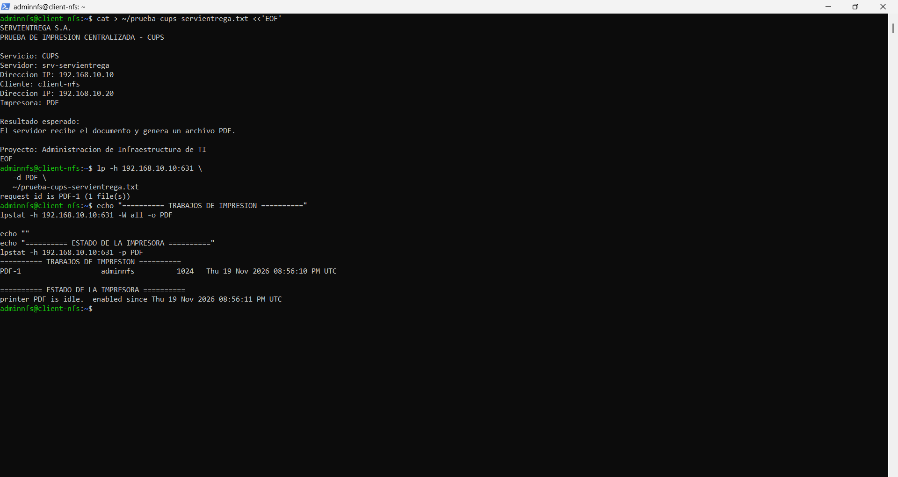
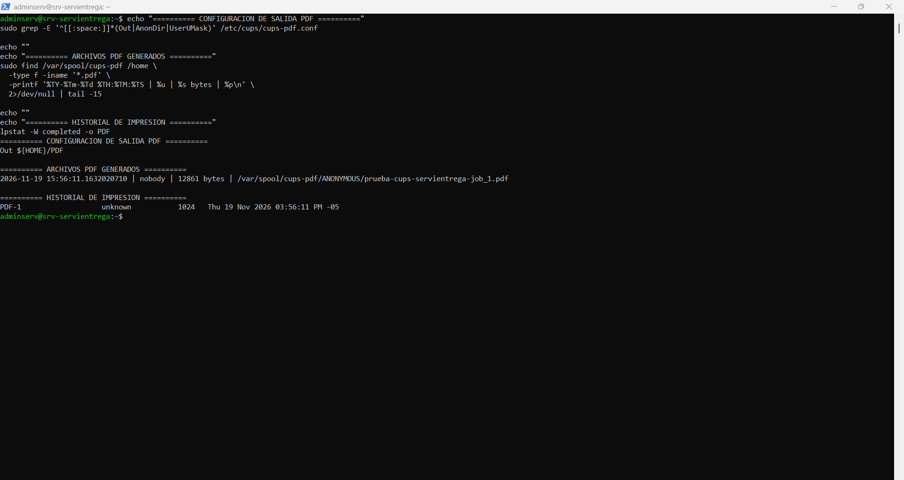

# Servicio 07 — CUPS: impresión centralizada

**Proyecto:** Administración de Infraestructura de TI — Sede simulada de Servientrega S.A.  
**Servicio:** CUPS (Common UNIX Printing System) con impresora PDF virtual  
**Documento:** `AdminTI/infraestructura/07-servicio-cups.md`  
**Fecha de validación:** 19 de noviembre de 2026  
**Estado:** Implementado y validado funcionalmente mediante impresión remota desde Ubuntu.

## 1. Objetivo

Implementar un servicio centralizado de impresión en el servidor Ubuntu de la sede simulada de Servientrega S.A., permitiendo que un equipo cliente de la red interna envíe documentos a una cola compartida. Ante la ausencia de una impresora física, se utiliza una impresora PDF virtual para comprobar la recepción, el procesamiento y la generación de un documento de salida.

El servicio atiende el requisito **RF-08 — CUPS** del plan de infraestructura. La validación se realiza desde un cliente Ubuntu conectado a la red privada del laboratorio.

## 2. Arquitectura y entorno

| Elemento | Configuración comprobada |
|---|---|
| Servidor | `srv-servientrega` |
| Sistema operativo del servidor | Ubuntu Server 24.04 LTS |
| Usuario administrativo | `adminserv` |
| IP del servidor en red interna | `192.168.10.10` |
| Cliente de pruebas | `client-nfs` (reutilizado como cliente de servicios) |
| Usuario del cliente | `adminnfs` |
| IP del cliente | `192.168.10.20` |
| Red privada | `192.168.10.0/24` (Host-only) |
| Protocolo | IPP sobre TCP, puerto `631` |
| Servidor de impresión | CUPS |
| Controlador virtual | `printer-driver-cups-pdf` |
| Cola de impresión | `PDF` |

**Flujo funcional:**

```text
Cliente Ubuntu (192.168.10.20)
    │
    │  lp -h 192.168.10.10:631 -d PDF archivo.txt
    ▼
Servidor CUPS (192.168.10.10:631)
    │
    ▼
Cola de impresión «PDF»
    │
    ▼
Controlador CUPS-PDF
    │
    ▼
/var/spool/cups-pdf/ANONYMOUS/
    └── prueba-cups-servientrega-job_1.pdf
```

El servidor también dispone de una interfaz de red puente para otros componentes del laboratorio; **CUPS no se configuró para escuchar en dicha interfaz**.

## 3. Prerrequisitos y comprobaciones iniciales

Antes de la instalación se comprobó que CUPS no estaba instalado, que no existía un proceso escuchando en el puerto `631` y que el gestor de paquetes no presentaba incidencias (`sudo dpkg --audit` sin salida).

Comandos utilizados:

```bash
dpkg-query -W cups cups-pdf 2>&1 || true
sudo ss -lntup | grep ':631 ' || true
systemctl is-active cups.service 2>&1 || true
systemctl is-enabled cups.service 2>&1 || true
apt-cache policy cups cups-pdf
```

La consulta inicial mostró una versión candidata de `cups` (`2.4.7-1.2ubuntu7.14`) y ninguna versión candidata para el nombre de paquete `cups-pdf`. Se verificó que el repositorio `universe` estaba habilitado y que el controlador adecuado en Ubuntu era **`printer-driver-cups-pdf`**:

```bash
apt-cache policy | grep -E 'noble/(main|universe)' | head -15
apt-cache search cups-pdf
apt-cache search printer-driver-cups-pdf
sudo dpkg --audit
```

## 4. Instalación en el servidor

En `srv-servientrega` se instalaron los paquetes:

```bash
sudo apt-get install -y cups printer-driver-cups-pdf
```

La instalación generó automáticamente la cola `PDF`, que quedó como impresora predeterminada. Se comprobó mediante:

```bash
dpkg-query -W -f='${binary:Package} ${Status}\n' \
  cups printer-driver-cups-pdf
systemctl is-active cups.service
systemctl is-enabled cups.service
lpstat -p -d
sudo ss -lntp | grep ':631 '
```

**Resultados observados:** ambos paquetes con estado `install ok installed`; servicio `active` y `enabled`; impresora `PDF` en estado `idle` y definida como destino predeterminado. Inicialmente CUPS escuchaba solo en `127.0.0.1:631` y `[::1]:631`.

## 5. Configuración del servidor

### 5.1 Respaldo y escucha en la red privada

Se creó un respaldo de la configuración original:

```bash
sudo cp -a /etc/cups/cupsd.conf \
  /etc/cups/cupsd.conf.bak-servientrega
```

Después se añadió una directiva de escucha específica para la IP interna:

```bash
sudo sed -i \
  '/^Listen localhost:631$/a Listen 192.168.10.10:631' \
  /etc/cups/cupsd.conf
```

Las directivas relevantes quedaron así:

```apache
Listen localhost:631
Listen 192.168.10.10:631
Listen /run/cups/cups.sock
```

Se evitó usar `Port 631` de forma general, para no escuchar indiscriminadamente en todas las interfaces de red.

### 5.2 Habilitación de la cola compartida

```bash
sudo lpadmin -p PDF -o printer-is-shared=true
```

La cola ya existía; **no fue necesario crear una segunda impresora**.

### 5.3 Autorización de acceso desde la red Host-only

La primera consulta remota devolvió `lpstat: Forbidden`. Para permitir la consulta y utilización del servicio desde la red privada, se modificó únicamente la sección general `<Location />` de `/etc/cups/cupsd.conf`:

```apache
<Location />
  Order allow,deny
  Allow from 192.168.10.0/24
</Location>
```

Se conservaron las secciones administrativas existentes (`/admin`, `/admin/conf` y `/admin/log`), con sus requisitos de autenticación. Esta configuración **no equivale a una auditoría completa de todas las políticas IPP**, por lo que no debe interpretarse como un control exhaustivo de autorización por usuario.

### 5.4 Validación y reinicio

```bash
sudo cupsd -t
sudo systemctl restart cups
systemctl is-active cups
sudo ss -lntp | grep ':631 '
sudo sed -n '/^<Location \/>/,/^<\/Location>/p' \
  /etc/cups/cupsd.conf
```

**Resultados observados:** `cupsd -t` declaró válidos `/etc/cups/cups-files.conf` y `/etc/cups/cupsd.conf`; el servicio permaneció `active` y las direcciones de escucha fueron:

```text
192.168.10.10:631
127.0.0.1:631
[::1]:631
```

Durante la validación apareció el aviso de CUPS sobre la futura retirada de controladores de impresión tradicionales. **Fue una advertencia de compatibilidad futura, no un fallo de configuración ni de impresión en esta instalación.**

## 6. Configuración del cliente Ubuntu

En `client-nfs`, primero se comprobó que el puerto `631` del servidor era accesible:

```bash
timeout 5 bash -c 'echo > /dev/tcp/192.168.10.10/631' \
  && echo 'Puerto 631 accesible' \
  || echo 'Puerto 631 no accesible'
```

El resultado fue `Puerto 631 accesible`. Sin embargo, inicialmente no estaban instaladas las herramientas `lp` ni `lpstat`. Se instaló exclusivamente el cliente de impresión:

```bash
sudo apt-get install -y cups-client
```

La presencia de las herramientas se confirmó con:

```bash
command -v lp
command -v lpstat
```

Ambas devolvieron sus rutas en `/usr/bin/`.

### 6.1 Consulta remota de la cola

```bash
lpstat -h 192.168.10.10:631 -p -d
lpstat -h 192.168.10.10:631 -r
lpstat -h 192.168.10.10:631 -a PDF
```

**Resultados observados después de corregir los permisos:**

```text
printer PDF is idle. enabled ...
system default destination: PDF
scheduler is running
PDF accepting requests since ...
```

La consulta remota dejó de devolver `Forbidden`.

## 7. Prueba funcional de impresión remota

### 7.1 Documento de prueba

En el cliente se creó el archivo `~/prueba-cups-servientrega.txt`:

```bash
cat > ~/prueba-cups-servientrega.txt <<'EOF'
SERVIENTREGA S.A.
PRUEBA DE IMPRESION CENTRALIZADA - CUPS

Servicio: CUPS
Servidor: srv-servientrega
Direccion IP: 192.168.10.10
Cliente: client-nfs
Direccion IP: 192.168.10.20
Impresora: PDF

Resultado esperado:
El servidor recibe el documento y genera un archivo PDF.

Proyecto: Administracion de Infraestructura de TI

EOF
```

### 7.2 Envío y validación

```bash
lp -h 192.168.10.10:631 -d PDF ~/prueba-cups-servientrega.txt
lpstat -h 192.168.10.10:631 -W all -o PDF
lpstat -h 192.168.10.10:631 -p PDF
```

**Resultados observados:** `request id is PDF-1 (1 file(s))`; el cliente mostró el trabajo `PDF-1` asociado a `adminnfs` y la impresora regresó al estado `idle`.

### 7.3 Comprobación del archivo generado en el servidor

```bash
sudo grep -E '^[[:space:]]*(Out|AnonDir|UserUMask)' /etc/cups/cups-pdf.conf
sudo find /var/spool/cups-pdf /home -type f -iname '*.pdf' \\
  -printf '%TY-%Tm-%Td %TH:%TM:%TS | %u | %s bytes | %p\\n' \\
  2>/dev/null | tail -15
lpstat -W completed -o PDF
```

Resultados reales:

```text
Out ${HOME}/PDF
2026-11-19 15:56:11.1632020710 | nobody | 12861 bytes | /var/spool/cups-pdf/ANONYMOUS/prueba-cups-servientrega-job_1.pdf
PDF-1                   unknown           1024   Thu 19 Nov 2026 03:56:11 PM -05
```

Se comprobó la existencia del archivo PDF de **12.861 bytes** y el registro del trabajo completado. El cliente mostró UTC y el servidor hora local UTC−05:00. No se ha proporcionado aún una comprobación adicional mediante `file` ni una inspección visual del PDF.

## 8. Incidencias y soluciones

| Incidencia | Solución | Resultado |
|---|---|---|
| `cups-pdf` no disponible | Usar `printer-driver-cups-pdf` | Controlador instalado |
| CUPS escuchaba solo en localhost | Añadir `Listen 192.168.10.10:631` | Acceso desde red privada |
| Cliente sin comandos de impresión | Instalar `cups-client` | `lp` y `lpstat` disponibles |
| `lpstat: Forbidden` | Autorizar `192.168.10.0/24` en `<Location />` | Consulta remota exitosa |
| Aviso sobre controladores obsoletos | Registrar para mantenimiento | No impidió imprimir |
| Identificación inconsistente del remitente | Documentar limitación | Cliente: `adminnfs`; servidor: `unknown`; PDF: `nobody` en `ANONYMOUS` |

## 9. Seguridad y limitaciones

- CUPS escucha en `127.0.0.1:631`, `[::1]:631` y `192.168.10.10:631`; no se observó escucha en la interfaz puente.
- La red privada `192.168.10.0/24` tiene acceso general al servicio. Se conservaron las restricciones de autenticación de las rutas administrativas.
- No se habilitó descubrimiento automático (`Browsing No` en la configuración revisada); el cliente utiliza `lp -h`.
- La prueba acredita impresión remota a PDF virtual, **no** autenticación individual, cifrado TLS, auditoría completa de permisos IPP ni impresión física.

## 10. Operación y mantenimiento

```bash
# En el servidor
systemctl status cups
systemctl is-enabled cups
sudo cupsd -t
lpstat -p -d
lpstat -a PDF
lpstat -W completed -o PDF
sudo ss -lntp | grep ':631 '
sudo journalctl -u cups --no-pager -n 50
sudo find /var/spool/cups-pdf -type f -iname '*.pdf'

# En el cliente
lpstat -h 192.168.10.10:631 -p -d
lp -h 192.168.10.10:631 -d PDF documento.txt
```

Conservar el respaldo de `cupsd.conf`, validar los cambios con `sudo cupsd -t` antes de reiniciar y comprobar que la escucha permanezca restringida a las interfaces previstas. Gestionar la retención de los PDF de prueba.

## 11. Evidencias visuales

**Captura 23 — Envío desde el cliente**  
Archivo previsto: `AdminTI/capturas/23-cups-impresion-desde-cliente.png`. Debe mostrar el identificador `PDF-1` y las consultas de la cola desde `client-nfs`.



**Captura 24 — PDF generado en el servidor**  
Archivo previsto: `AdminTI/capturas/24-cups-pdf-generado-servidor.png`. Debe mostrar el PDF creado y el historial del trabajo completado.



Para preparar la segunda captura:

```bash
systemctl is-active cups
sudo ls -lh /var/spool/cups-pdf/ANONYMOUS/prueba-cups-servientrega-job_1.pdf
sudo file /var/spool/cups-pdf/ANONYMOUS/prueba-cups-servientrega-job_1.pdf
lpstat -W completed -o PDF
```

**Pendiente documental:** confirmar que ambas imágenes estén guardadas con los nombres indicados. El último bloque se propone para la evidencia visual, pero su salida no ha sido aportada.

## 12. Conclusión

El servicio CUPS quedó **implementado y validado funcionalmente** en la sede simulada de Servientrega S.A. El cliente Ubuntu `192.168.10.20` consultó la cola `PDF` del servidor `192.168.10.10:631`, envió el trabajo `PDF-1` y el servidor generó `/var/spool/cups-pdf/ANONYMOUS/prueba-cups-servientrega-job_1.pdf` de 12.861 bytes.

**RF-08 — CUPS:** cumplido para el escenario de laboratorio (impresión remota a PDF virtual). **Pendiente de cierre documental:** verificar y adjuntar las capturas 23 y 24.
