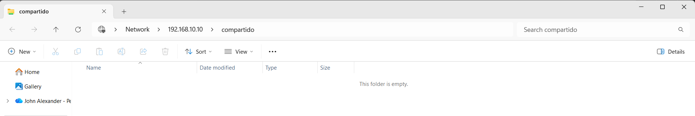
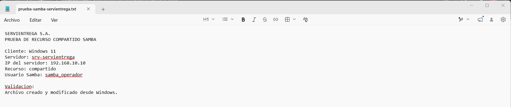
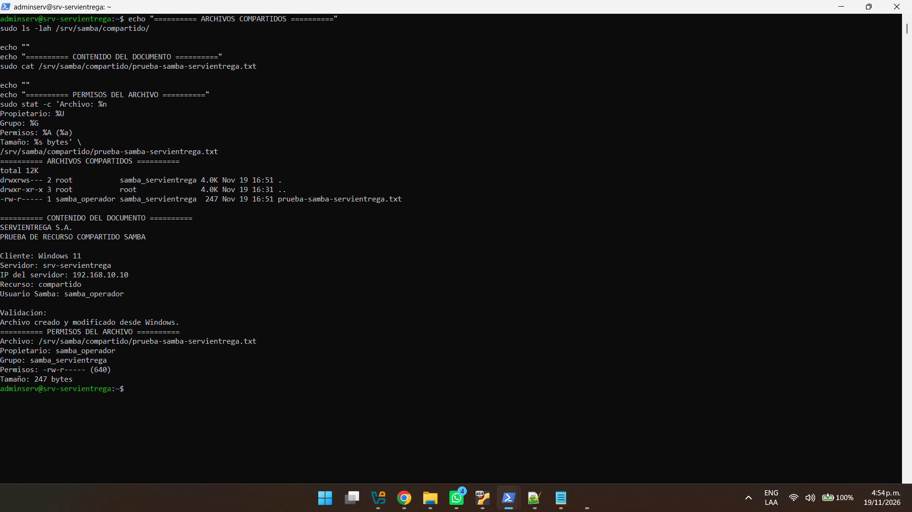

# 08. Servicio Samba — Compartición de archivos con Windows

**Proyecto:** Administración de Infraestructura de TI — Sede simulada Servientrega S.A.  
**Plataforma:** Ubuntu Server 24.04 LTS (servidor) y Windows 11 (cliente)  
**Servidor:** `srv-servientrega` — `192.168.10.10` (red Host-only)  
**Estado:** Implementado y validado funcionalmente el 19 de noviembre de 2026.

## 1. Objetivo y alcance

Implementar un recurso compartido mediante SMB para que un equipo Windows 11 pueda acceder con credenciales, crear y modificar documentos alojados en el servidor Ubuntu. El servicio opera en la red privada `192.168.10.0/24` y utiliza un directorio independiente de las exportaciones NFS y de los datos de NIS.

El alcance corresponde a un laboratorio académico con cuentas ficticias. No se configura un dominio Active Directory ni un servicio de archivos expuesto a Internet.

## 2. Arquitectura

| Componente | Configuración implementada |
|---|---|
| Servidor | `srv-servientrega`, Ubuntu Server 24.04 LTS |
| IP de servicio | `192.168.10.10` |
| Cliente de validación | Windows 11, interfaz Host-only `192.168.10.1` |
| Protocolo | SMB, principalmente TCP 445; TCP 139 disponible en interfaz interna |
| Nombre NetBIOS | `SRV-SERV` |
| Recurso | `compartido` |
| Ruta local | `/srv/samba/compartido` |
| Ruta Windows | `\\192.168.10.10\compartido` |
| Usuario autorizado | `samba_operador` (UID 1003) |
| Grupo | `samba_servientrega` (GID 1003) |
| Servicios | `smbd` y `nmbd` |

**Flujo validado:** Windows 11 → red Host-only → Samba en `192.168.10.10` → `/srv/samba/compartido`.

## 3. Prerrequisitos

- Servidor Ubuntu y red Host-only operativos.
- Conectividad entre Windows y `192.168.10.10`.
- Acceso administrativo por SSH como `adminserv`, con capacidad de ejecutar `sudo`.
- Repositorios de Ubuntu disponibles para instalar `samba`, `samba-common-bin` y `smbclient`.
- Puertos SMB 139 y 445 libres antes de la instalación.

La comprobación inicial mostró Samba no instalado, servicios inactivos y puertos disponibles. `sudo dpkg --audit` no reportó incidencias.

## 4. Instalación del servicio

En `srv-servientrega` se ejecutó:

```bash
sudo apt-get install -y samba samba-common-bin smbclient
```

Comprobaciones:

```bash
dpkg-query -W -f='${binary:Package} ${Status}\n' samba samba-common-bin smbclient
systemctl is-active smbd
systemctl is-enabled smbd
smbd --version
sudo testparm -s
sudo ss -lntp | grep -E ':(139|445) '
```

**Resultados observados:** los tres paquetes figuraron como `install ok installed`; `smbd` estaba `active` y `enabled`; versión `4.19.5-Ubuntu`. Inicialmente el servicio escuchaba en `0.0.0.0` y `[::]` para los puertos 139/445. `testparm` advirtió además que el nombre NetBIOS derivado del hostname era demasiado largo.

## 5. Restricción de interfaces y acceso

Se respaldó la configuración original:

```bash
sudo cp -a /etc/samba/smb.conf /etc/samba/smb.conf.bak-servientrega
```

Se añadieron los siguientes parámetros a la sección `[global]` de `/etc/samba/smb.conf`:

```ini
[global]
   netbios name = SRV-SERV
   interfaces = lo 192.168.10.10/24
   bind interfaces only = yes
   hosts allow = 127. 192.168.10.
   hosts deny = ALL
   server min protocol = SMB2_02
   restrict anonymous = 2
```

Estos parámetros complementan el resto de opciones preexistentes de `[global]`; no representan el contenido íntegro del archivo.

Se validó y reiniciaron los servicios:

```bash
sudo testparm -s
sudo systemctl restart smbd nmbd
systemctl is-active smbd
systemctl is-active nmbd
sudo ss -lntp | grep -E ':(139|445) '
```

**Resultados observados:** `Loaded services file OK`, `smbd` y `nmbd` activos. Los sockets TCP 139/445 quedaron escuchando en `192.168.10.10`, `127.0.0.1` y `[::1]`, sin escucha en `0.0.0.0` ni en la interfaz puente. Desapareció la advertencia de longitud del nombre NetBIOS.

> La restricción por interfaz y por `hosts allow` limita el servicio en este laboratorio. No se documenta como prueba de un cortafuegos perimetral ni como una auditoría exhaustiva de seguridad.

## 6. Usuario, grupo y directorio compartido

Se creó un grupo dedicado y un usuario local sin inicio de sesión interactivo:

```bash
sudo groupadd samba_servientrega
sudo useradd -M -s /usr/sbin/nologin -g samba_servientrega samba_operador
```

Se preparó un directorio separado de NFS:

```bash
sudo mkdir -p /srv/samba/compartido
sudo chown root:samba_servientrega /srv/samba/compartido
sudo chmod 2770 /srv/samba/compartido
```

Validación:

```bash
id samba_operador
getent group samba_servientrega
ls -ld /srv/samba/compartido
sudo -u samba_operador test -w /srv/samba/compartido \
  && echo 'Permiso de escritura correcto'
```

**Resultados observados:** UID/GID `1003`; directorio `drwxrws--- root samba_servientrega`; prueba de escritura correcta. El bit *setgid* del directorio facilita la herencia del grupo para los elementos nuevos.

### 6.1. Cuenta Samba

Se registró y habilitó la cuenta en la base de autenticación de Samba:

```bash
sudo smbpasswd -a samba_operador
sudo smbpasswd -e samba_operador
```

La contraseña se introdujo de forma interactiva y no se incluye en la documentación. La autenticación posterior con `smbclient` permitió listar el recurso, confirmando que la cuenta pudo utilizarse.

## 7. Publicación del recurso

Se añadió al final de `/etc/samba/smb.conf`:

```ini
# Recurso compartido - Servientrega S.A.
[compartido]
   comment = Archivos compartidos de Servientrega
   path = /srv/samba/compartido
   browseable = yes
   read only = no
   guest ok = no
   valid users = samba_operador
   force group = samba_servientrega
   create mask = 0660
   directory mask = 2770
```

Se ejecutó:

```bash
sudo testparm -s
sudo testparm -s 2>/dev/null | sed -n '/^\[compartido\]/,$p'
sudo systemctl restart smbd
systemctl is-active smbd
smbclient -L //127.0.0.1 -U samba_operador
```

**Resultados observados:** `Loaded services file OK`; el recurso `[compartido]` apareció en `testparm`; `smbd` continuó `active`; `smbclient` mostró `compartido` como recurso de tipo `Disk` y la descripción **Archivos compartidos de Servientrega**. La salida informó `SMB1 disabled -- no workgroup available`, compatible con el uso de SMB moderno.

**Nota sobre permisos:** `create mask = 0660` es un límite máximo, no una garantía de que todo archivo tenga exactamente ese modo. En la prueba real, el archivo creado desde Windows quedó con permisos `0640`, que se documentan tal como fueron observados.

## 8. Pruebas funcionales y resultados

### 8.1. Acceso desde Windows 11

En el Explorador de archivos se abrió:

```text
\\192.168.10.10\compartido
```

Se indicó el usuario `SRV-SERV\samba_operador` y su contraseña Samba cuando fue necesario. **Resultado:** Windows mostró el recurso compartido, inicialmente vacío, sin error de acceso.

### 8.2. Creación, escritura y lectura desde Windows

Dentro del recurso se creó el archivo:

```text
prueba-samba-servientrega.txt
```

El contenido de prueba identificó a Servientrega S.A., al cliente Windows 11, al servidor `srv-servientrega`, la IP `192.168.10.10`, el recurso `compartido` y el usuario `samba_operador`. Se guardó y verificó su contenido desde el servidor Ubuntu.

### 8.3. Comprobación en Ubuntu

El usuario administrativo `adminserv` no podía acceder directamente al directorio porque no pertenecía al grupo `samba_servientrega`; esto era coherente con los permisos `2770`. Se utilizó `sudo` para inspeccionar sin debilitar los permisos:

```bash
sudo ls -lah /srv/samba/compartido/
sudo cat /srv/samba/compartido/prueba-samba-servientrega.txt
sudo stat -c 'Archivo: %n
Propietario: %U
Grupo: %G
Permisos: %A (%a)
Tamaño: %s bytes' \
  /srv/samba/compartido/prueba-samba-servientrega.txt
```

**Resultados verificados en la terminal:**

| Elemento | Resultado |
|---|---|
| Archivo | `/srv/samba/compartido/prueba-samba-servientrega.txt` |
| Propietario | `samba_operador` |
| Grupo | `samba_servientrega` |
| Permisos | `-rw-r-----` (`640`) |
| Tamaño | `247 bytes` |
| Contenido | Texto de prueba creado y modificado desde Windows, leído correctamente en Ubuntu |

**Conclusión de la prueba:** el recurso SMB permitió acceso desde Windows, creación de un archivo y lectura de su contenido en Ubuntu. La prueba confirma la integración funcional entre ambos sistemas.

## 9. Incidencias y decisiones técnicas

| Situación | Tratamiento y resultado |
|---|---|
| Nombre NetBIOS demasiado largo | Se definió `netbios name = SRV-SERV`; la advertencia desapareció. |
| Samba inicialmente escuchaba en todas las interfaces | Se configuraron `interfaces`, `bind interfaces only` y filtros de hosts; se verificaron los sockets internos. |
| `adminserv` no podía entrar directamente al directorio | Comportamiento esperado por permisos `2770`; inspección administrativa con `sudo`, sin aplicar `chmod 777`. |
| Advertencia `Weak crypto is allowed by GnuTLS` | Se registró como advertencia de compatibilidad; no se interpretó como fallo ni como prueba de uso efectivo de criptografía débil. |
| SMB1 deshabilitado | Se mantuvo deshabilitado; no fue necesario habilitarlo para Windows 11. |

## 10. Seguridad y limitaciones

- El recurso requiere credenciales Samba: `guest ok = no` y `valid users = samba_operador`.
- El usuario local tiene shell `/usr/sbin/nologin` y no fue creado para acceso interactivo.
- Los archivos residen en un directorio dedicado con grupo y permisos restringidos; no se reutilizan carpetas NFS.
- Los sockets SMB quedaron asociados a la interfaz Host-only y localhost, no a la interfaz puente.
- Se configuró un protocolo mínimo SMB2 y se observó SMB1 deshabilitado.
- Se preservó el archivo de configuración original en `/etc/samba/smb.conf.bak-servientrega`.
- No se ejecutó una prueba independiente de acceso denegado desde la interfaz puente, ni una prueba formal de acceso sin credenciales. Por ello, no se afirma que tales pruebas hayan sido completadas.
- La instalación conservó los recursos predeterminados `[printers]` y `[print$]`; el alcance de la validación se centró en `[compartido]`.

## 11. Operación y mantenimiento

Comandos de consulta habituales:

```bash
systemctl status smbd nmbd --no-pager
sudo testparm -s
sudo ss -lntp | grep -E ':(139|445) '
smbclient -L //127.0.0.1 -U samba_operador
sudo ls -lah /srv/samba/compartido/
sudo journalctl -u smbd -n 50 --no-pager
```

Para gestionar credenciales de laboratorio:

```bash
sudo smbpasswd samba_operador
sudo pdbedit -L
```

Buenas prácticas: conservar copias de seguridad de `smb.conf`, aplicar actualizaciones de seguridad en una ventana de mantenimiento, revisar los permisos del directorio y comprobar periódicamente el acceso desde Windows. No almacenar contraseñas en capturas ni en el repositorio.

## 12. Evidencias del proyecto

Las imágenes se almacenan en `AdminTI/capturas/` y se referencian desde `AdminTI/infraestructura/08-servicio-samba.md`.

| Captura | Archivo | Evidencia |
|---|---|---|
| 25 | `25-samba-acceso-windows.png` | Explorador de Windows abierto en `\\192.168.10.10\compartido` |
| 26 | `26-samba-escritura-windows.png` | Archivo de prueba creado en el recurso desde Windows; verificar que se haya guardado la imagen |
| 27 | `27-samba-verificacion-ubuntu.png` | Terminal Ubuntu con listado, contenido, propietario, grupo y permisos del archivo |

**Estado de evidencias:** se mostraron en la conversación las capturas de acceso Windows (25) y validación Ubuntu (27). La creación del archivo en Windows fue confirmada por el usuario y comprobada en Ubuntu; la existencia física de la captura 26 en `AdminTI/capturas/` debe confirmarse al integrar el documento.

### Referencias relativas para Markdown







## 13. Criterio de cierre

**Servicio Samba implementado y validado funcionalmente** en el laboratorio: servidor activo, recurso autenticado publicado, interfaces de escucha restringidas y prueba de creación/lectura de archivo desde Windows a Ubuntu completada. La documentación de seguridad distingue entre controles configurados y pruebas efectivamente realizadas. Queda pendiente confirmar el almacenamiento de todas las capturas previstas en la carpeta del proyecto.
